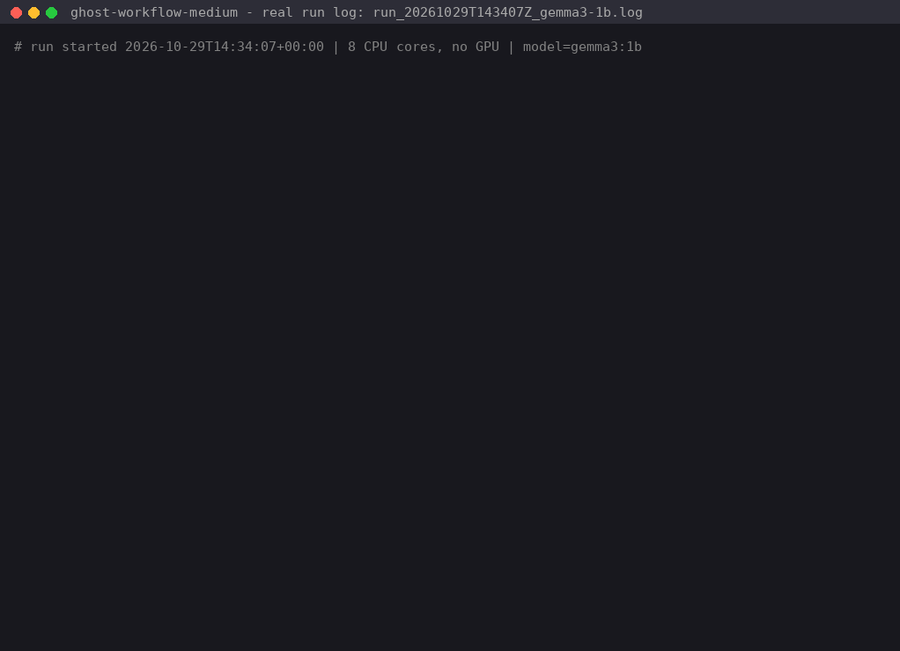
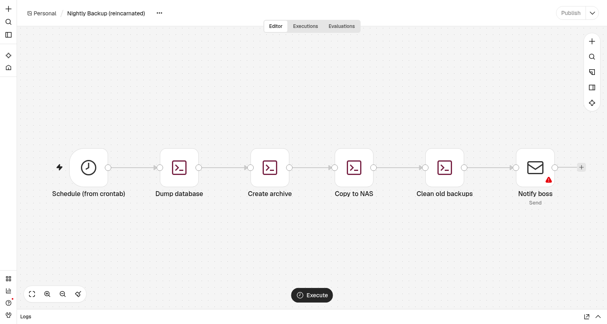
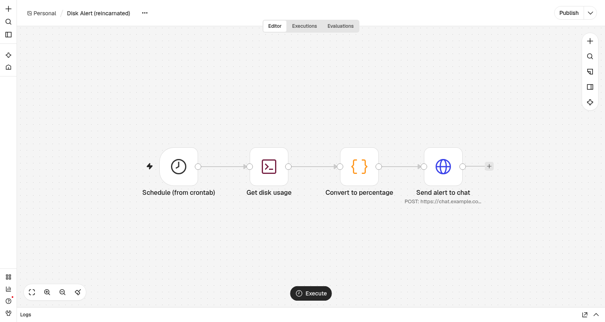

# 👻 Ghost Workflow Medium

**A local, offline séance for dead scripts.** Feed it an old cron job, bash script or Python 2 report. A small open-weight **Gemma 3** model running in **Ollama** speaks *as the ghost* and says what the script did in life. Then the tool reincarnates the script as an **n8n workflow JSON** that you can import.

Built for the DEV Hacktoberfest Open-Source AI Challenge, Week 4: *Ghost in the Machine*.



## Why

Every small business has ghosts in its machines: a crontab line nobody remembers writing, or a weekly report that "just works". When the person who wrote it leaves, the knowledge goes with them. These scripts often contain internal hostnames, paths and email addresses, so you may not want to paste them into a cloud model. Everything here runs on one CPU-only machine, with no API keys and no network calls except to `localhost:11434`.

## How it works

```
old script ──► Gemma (confession, in character, 3 sentences)        ──► reborn/<name>.story.txt
          └──► Gemma (structured "plan" via Ollama JSON-schema output) ──► reborn/<name>.plan.json
                     │
                     ▼  deterministic guardrails (no LLM)
               repair + grounding ("exorcism")
                     │
                     ▼
               n8n_compiler.py ──► reborn/<name>.json ──► validate.py ──► n8n import:workflow
```

A 1B model can't write a full n8n workflow JSON reliably, so it doesn't have to. Gemma only fills in a small JSON schema: a trigger (`schedule` / `webhook` / `manual` plus a cron expression) and 1–6 steps (`command` / `http` / `email` / `code` / `readFile` / `writeFile`). Plain Python then compiles that plan into real n8n nodes:

| plan step | n8n node |
|---|---|
| schedule trigger | `n8n-nodes-base.scheduleTrigger` (cron expression) |
| webhook / manual | `n8n-nodes-base.webhook` / `manualTrigger` |
| command | `n8n-nodes-base.executeCommand` |
| http | `n8n-nodes-base.httpRequest` |
| email | `n8n-nodes-base.emailSend` |
| readFile / writeFile | `n8n-nodes-base.readWriteFile` |
| code | `n8n-nodes-base.code` (the ghost's intent plus a `TODO`) |

### Guardrails (where the small model gets caught)

Small models make mistakes. These checks catch them and print a note in the log:

- **🔧 repair**:
  - If the model pastes the whole crontab line into `cron`, the field is trimmed to the 5 schedule fields.
  - An `http` step with no URL in it (for example `scp`) is re-typed as a shell command.
- **🧿 exorcism**: a step is removed if it points at a URL or email address that doesn't appear in the original script. In the real runs below, gemma3:1b once made up a status endpoint, `http://192.168.1.20:12345/status.html`, on the NAS address that the script only `scp`s to. In another run it copied `https://hooks.example.org/done` from the few-shot example in the prompt. Both steps were removed.
- **Structural validation** (`validate.py`):
  - The workflow has exactly one trigger, at least one action, unique node names and known node types.
  - The cron expression has 5 fields.
  - Every connection points to a real node, and every node is reachable from the trigger.
  - On failure, the validator's errors go back to Gemma for one retry (`--retries`).

## Quick start

Requirements: Python 3.9+ (stdlib only), [Ollama](https://ollama.com), and about 1 GB of disk for `gemma3:1b`.

```bash
ollama pull gemma3:1b            # ~800 MB download, runs on CPU
python3 medium.py ghosts/* --model gemma3:1b --out reborn
python3 validate.py reborn/backup_cron_2009.json reborn/disk_alert.json reborn/weekly_sales_report.json

# or run everything with a timestamped log:
./run_demo.sh gemma3:1b reborn
./run_demo.sh gemma3:4b reborn_gemma3-4b    # bigger model, more complete plans, about 5x slower

# offline unit tests (no model needed)
python3 -m unittest discover tests

# optional: import the results into a throwaway n8n with the n8n CLI
npm i n8n
N8N_BIN=./node_modules/.bin/n8n ./n8n_import_check.sh reborn
```

Environment variables: `OLLAMA_URL` (default `http://localhost:11434`) and `GHOST_THREADS` (CPU threads, default 4).

To import by hand, open n8n and use **Workflows → Import from File**, then select one of the `reborn/*.json` files. Workflows are imported **inactive**.

> **Note:** recent n8n versions disable the *Execute Command* node by default; it shows as a "?" node. To use it on a self-hosted instance you trust, start n8n with `NODES_EXCLUDE="[]"`. Otherwise, swap those nodes for an SSH or Code node.

## Example séance (real output, gemma3:1b, 8-core CPU, no GPU)

Input: `ghosts/backup_cron_2009.sh` (cron `0 3 * * *`: mysqldump → tar → scp to the NAS → delete old backups → mail the boss)

```
🕯  Summoning the ghost of backup_cron_2009.sh with gemma3:1b ...
👻 Alright, let's see… I was the keeper of this little business, a silent observer, and my every action was vital. I meticulously copied the shop's data, ensuring everything was safe, and then meticulously archived it, safeguarding the business's future. Without me, the shop would cease to exist, and the records would vanish into the digital void. ...
   (confession: 97 tokens, 3.9s)
   (plan attempt 1: 149 tokens, 9.1s)
   🧿 exorcised step 'Send Notification': http://192.168.1.20:12345/status.html is not in the original script
✨ Reincarnated -> reborn/backup_cron_2009.json (3 nodes: scheduleTrigger -> executeCommand -> emailSend); structure check passed
```

The same ghost with `gemma3:4b`:

```
👻 I awoke each morning precisely at 3:00 AM, initiating the relentless cycle of database backups and file archives. ...
   (confession: 81 tokens, 23.0s)
   (plan attempt 1: 277 tokens, 41.4s)
   🔧 re-typed step 'Copy to NAS' as a shell command (no URL in it)
✨ Reincarnated -> reborn_gemma3-4b/backup_cron_2009.json (6 nodes: scheduleTrigger -> executeCommand -> executeCommand -> executeCommand -> executeCommand -> emailSend); structure check passed
```

Imported into n8n 2.45.6 with the CLI and opened in the editor:




## 1B vs 4B (from the logs in `logs/`)

| ghost | gemma3:1b | gemma3:4b |
|---|---|---|
| backup_cron_2009.sh | 3 nodes: schedule → mysqldump → email (skipped tar, scp and cleanup; one made-up URL removed) | 6 nodes: schedule → dump → archive → copy to NAS → clean old backups → email |
| disk_alert.sh | 2 nodes: schedule → command (the curl call; the df check was dropped) | 4 nodes: schedule → df → code → HTTP POST to the real webhook |
| weekly_sales_report.py | 3 nodes: schedule → command → email (copied example URL removed) | 2 nodes: schedule → one code node holding the whole script (weak) |
| time for all 3 ghosts | ~34 s | ~2.5 min |

Both models get every schedule right (`0 3 * * *`, `*/30 * * * *`, `0 8 * * 1`), and all 6 outputs pass validation and import into n8n. Out of the box, 1B gives you a skeleton and 4B gives you a draft. The 4B confessions are more vivid, but they also invent details: the sales script's owner became "Mr. Henderson", who isn't in the script.

## Limitations (honest)

- The output is a **scaffold** to review, not a finished migration. It has no credentials (SMTP, SSH), the Code nodes contain `TODO`s, and shell commands are copied as written.
- Small models drop steps. The guardrails remove made-up steps, but they can't add back steps the model skipped.
- Outputs can differ between runs and machines; always review before activating.
- Only linear workflows (no branches/IF nodes yet).

## Files

```
medium.py            séance: prompts, Ollama calls, repair/grounding, retry loop
n8n_compiler.py      plan → n8n workflow JSON (deterministic)
validate.py          structural validator (CLI + library)
run_demo.sh          full run with a timestamped log
n8n_import_check.sh  import into a throwaway n8n via CLI
ghosts/              three sample "dead" scripts
reborn/              gemma3:1b outputs (story, plan, workflow)
reborn_gemma3-4b/    gemma3:4b outputs
logs/                raw run logs and n8n import logs
docs/                GIF/PNG rendered from the logs, n8n screenshots, renderer script
tests/               offline unit tests
```

## License

MIT. See [LICENSE](LICENSE). Gemma models are subject to the [Gemma Terms of Use](https://ai.google.dev/gemma/terms).
